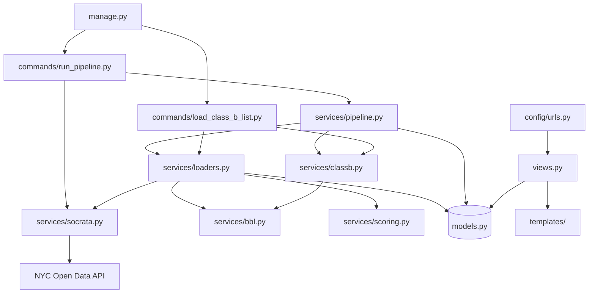
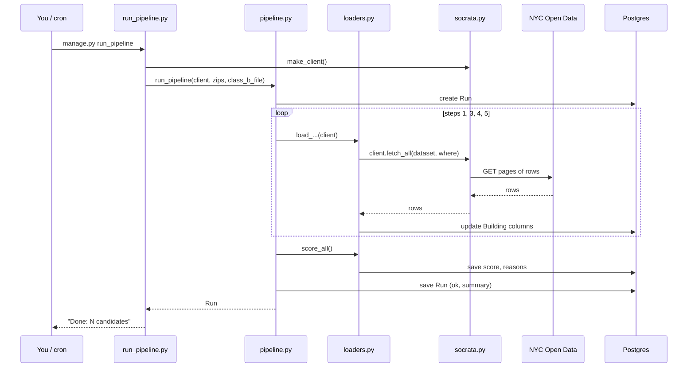
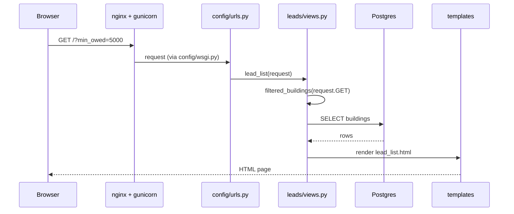

# Code flow: which file calls which

This document follows the code in the order it runs. There are three entry points: the pipeline command, the Class B list command, and a web request. For each one, the numbered steps show the file, the function, and what it does.

For the data rules behind each step see [data-sources.md](data-sources.md); for setup see [developer-guide.md](developer-guide.md).

## File map

| File | Role | Called by |
| --- | --- | --- |
| `manage.py` | Django's command-line entry point | You, cron |
| `config/settings.py` | Reads `.env`; holds database, zip codes, unit limits, API URL and token | Loaded first by everything |
| `config/urls.py` | Maps URLs to view functions | Django, on every web request |
| `config/wsgi.py` | Entry point for gunicorn in production | gunicorn |
| `leads/management/commands/run_pipeline.py` | Command: full data run | `manage.py run_pipeline` |
| `leads/management/commands/load_class_b_list.py` | Command: apply the Class B spreadsheet | `manage.py load_class_b_list` |
| `leads/services/pipeline.py` | Runs the six steps in order and records a `Run` | `run_pipeline.py` |
| `leads/services/socrata.py` | Talks to the NYC Open Data API | `loaders.py` (through the client object) |
| `leads/services/loaders.py` | One function per data source; writes to `Building` | `pipeline.py`, `load_class_b_list.py` |
| `leads/services/classb.py` | Reads the Class B spreadsheet | `pipeline.py`, `load_class_b_list.py` |
| `leads/services/bbl.py` | Builds and splits BBL numbers | `loaders.py`, `classb.py` |
| `leads/services/scoring.py` | Turns one building's signals into a score and reasons | `loaders.score_all` |
| `leads/models.py` | Database tables: `Building`, `Note`, `Run` | loaders, pipeline, views, admin |
| `leads/views.py` | Web pages and CSV export | `config/urls.py` |
| `leads/templates/` | HTML for the pages | `views.py` |
| `leads/admin.py` | Registers the tables in Django admin | Django admin |
| `leads/migrations/` | Database schema history | `manage.py migrate` |
| `leads/tests/` | Tests; `fakes.py` replaces the API client | `manage.py test leads` |

## Dependency overview

Arrows mean "calls".

Rule of thumb: commands and views are thin, `pipeline.py` decides the order, `loaders.py` does the work, and `scoring.py`, `bbl.py` and the two summary functions in `loaders.py` are pure functions with no database or network access.

## Flow 1: `python manage.py run_pipeline`

This is the main flow. It loads all data and scores every building.

Step by step:

1. **`manage.py`** sets `DJANGO_SETTINGS_MODULE=config.settings` and hands control to Django.
2. **`config/settings.py`** loads `.env` and builds the settings: `DATABASES`, `TARGET_ZIP_CODES`, `CLASS_B_LIST_FILE`, `SOCRATA_APP_TOKEN`, and the unit limits.
3. **`leads/management/commands/run_pipeline.py` → `Command.handle()`**
   - Reads `--zips`, or falls back to `settings.TARGET_ZIP_CODES`. Stops with an error if there are none.
   - Reads `--class-b-file`, or falls back to `settings.CLASS_B_LIST_FILE`.
   - Calls `make_client()` in `services/socrata.py` to build a `SocrataClient` with the base URL and app token.
   - Calls `run_pipeline(client, zips, class_b_file, log)` in `services/pipeline.py`.
4. **`leads/services/pipeline.py` → `run_pipeline()`**
   - Creates a `Run` row (`leads/models.py`) with the start time.
   - Calls the steps below in order, storing each step's count in a `summary` dictionary.
   - On success sets `run.ok = True`. On any exception stores the error text and re-raises.
   - In both cases saves `summary` and the finish time on the `Run`.

   The steps it calls:

   | # | Call | File | What happens |
   | --- | --- | --- | --- |
   | 1 | `load_hpd_buildings(client, zips)` | `loaders.py` | Builds the `$where` filter (zip codes + unit rule), fetches matching HPD buildings, creates or updates one `Building` per `buildingid`. Uses `make_bbl` from `bbl.py`. Sets `first_seen` on new rows and `last_seen` on all. |
   | 2 | `read_spreadsheet(file)` → `parse_class_b_rows(rows)` → `apply_class_b_list(bins, bbls)` | `classb.py`, then `loaders.py` | Only if a file was given. Reads the spreadsheet, extracts BINs and BBLs, then sets `on_class_b_list` on matching buildings and clears it on the rest. |
   | 3 | `load_tax_balances(client)` | `loaders.py` | Takes every building's BBL in batches of 50, fetches charge rows, passes them to `summarize_charges()` (same file, pure function), writes `tax_owed`, `unpaid_periods`, `tax_as_of`. |
   | 4 | `load_lien_lists(client)` | `loaders.py` | Fetches lien list rows for the buildings' zip codes, passes them to `latest_lien_by_bbl()` (pure function), clears old lien fields, writes `lien_stage`, `lien_month`, `lien_water_only`. |
   | 5 | `load_registrations(client)` | `loaders.py` | Takes registration IDs in batches of 50, fetches registrations and contacts, writes `registration_end`, `owner_name`, `agent_name`. |
   | 6 | `score_all()` | `loaders.py` → `scoring.py` | For each building calls `score_building(...)`, which returns `(score, reasons)`; saves both. |

5. **Inside every loader: `leads/services/socrata.py` → `SocrataClient.fetch_all()`**
   - Sends `GET <base>/<dataset_id>.json` with `$where`, `$select`, `$limit=5000`, `$offset`, `$order=:id`, and the `X-App-Token` header.
   - Yields rows one by one. Requests the next page until a page comes back with fewer than 5,000 rows.
   - Helpers `in_clause()` and `chunked()` in the same file build the batched `in (...)` filters.
6. **Back in `run_pipeline.py`**: prints the summary line. If the pipeline raised, it converts the error to a `CommandError`, so the command exits non-zero and cron logs it.

## Flow 2: `python manage.py load_class_b_list --file <path>`

Use this when the city republishes the list and you do not want a full run.

1. **`manage.py`** → **`config/settings.py`** (as above).
2. **`leads/management/commands/load_class_b_list.py` → `Command.handle()`**
   - Checks the file exists.
   - Calls `read_spreadsheet(path)` in `services/classb.py`: opens `.xls` (xlrd), `.xlsx` (openpyxl) or `.csv`, finds the header row, returns a list of dictionaries.
   - Calls `parse_class_b_rows(rows)` in `services/classb.py`: returns a set of BINs and a set of BBLs. Uses `make_bbl` from `bbl.py` when the sheet has borough, block and lot columns.
   - Calls `apply_class_b_list(bins, bbls)` in `services/loaders.py`: flags matching buildings. Raises `ValueError` if both sets are empty, so a bad file cannot wipe the flags.
   - Calls `score_all()` in `services/loaders.py` so scores reflect the new flags.
   - Prints how many BINs and BBLs were in the file and how many buildings matched.

## Flow 3: a web request

Example: the client opens the lead list with a filter.

1. **Entry.** In development `manage.py runserver` serves the request. In production nginx forwards it to gunicorn, which loads **`config/wsgi.py`**.
2. **Middleware** listed in `config/settings.py` runs: sessions, CSRF, authentication.
3. **`config/urls.py`** matches the path to a view:

   | URL | View in `leads/views.py` | Template |
   | --- | --- | --- |
   | `/` | `lead_list` | `leads/lead_list.html` |
   | `/export.csv` | `lead_export` | none (writes CSV) |
   | `/building/<id>/` | `lead_detail` | `leads/lead_detail.html` |
   | `/runs/` | `run_list` | `leads/run_list.html` |
   | `/login/`, `/logout/` | Django's built-in auth views | `registration/login.html` |
   | `/admin/` | Django admin, configured by `leads/admin.py` | Django's own |

4. **`@login_required`** on each view redirects anonymous users to `/login/`.
5. **The view runs:**
   - **`lead_list`** calls `filtered_buildings(request.GET)` (same file), which applies the zip, Class B, status and minimum-tax filters and sorts by score. It paginates 50 per page and renders the template.
   - **`lead_export`** calls the same `filtered_buildings()` and writes one CSV row per building.
   - **`lead_detail`** on GET loads one `Building` and renders it. On POST it reads `action`: `note` creates a `Note` with the logged-in user; `status` validates the value and saves it. Then it redirects back to the page.
   - **`run_list`** loads the latest 50 `Run` rows.
6. **`leads/models.py`** supplies the data and a few computed properties used by templates: `address`, `verification_level`, `dob_certificates_url`, `hpd_online_url`.
7. **Templates** all extend `leads/templates/leads/base.html` (header, navigation, styles).

Web requests never call the city API. They only read what the pipeline stored.

## Flow 4: `python manage.py test leads`

1. Django creates a temporary test database and applies `leads/migrations/`.
2. It discovers `leads/tests/test_*.py`.
3. Loader, pipeline and command tests pass a `FakeClient` from `leads/tests/fakes.py` in place of `SocrataClient`. It returns canned rows per dataset ID and records each query, so tests can assert on the `$where` text.
4. Command tests patch `make_client` to return that fake.
5. View tests use Django's test client with a logged-in user.

## Where to look when something is wrong

| Symptom | Start in |
| --- | --- |
| A building is missing from the list | `load_hpd_buildings` in `loaders.py` (the `$where` filter), then `.env` zip codes and unit limits |
| Tax owed looks wrong | `summarize_charges` in `loaders.py` |
| Wrong or missing lien stage | `latest_lien_by_bbl` in `loaders.py` |
| Owner name empty | `load_registrations` in `loaders.py` (field names) |
| Class B flags all empty | `parse_class_b_rows` in `classb.py` (column names) |
| Score seems off | `scoring.py` (weights), and the "Why" column |
| API error (HTTP 400, 429) | `socrata.py`; 400 usually means a field name in a loader's `$where` |
| Filter or CSV wrong | `filtered_buildings` in `views.py` |
| Page layout | the template named in the URL table above |
| Run shows "Failed" | the error text on the Run history page, then `pipeline.py` to see which step it was in |
