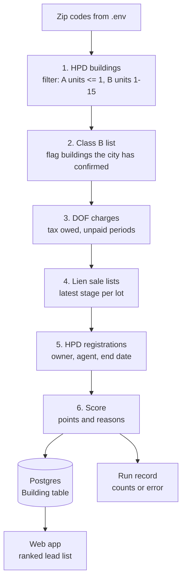
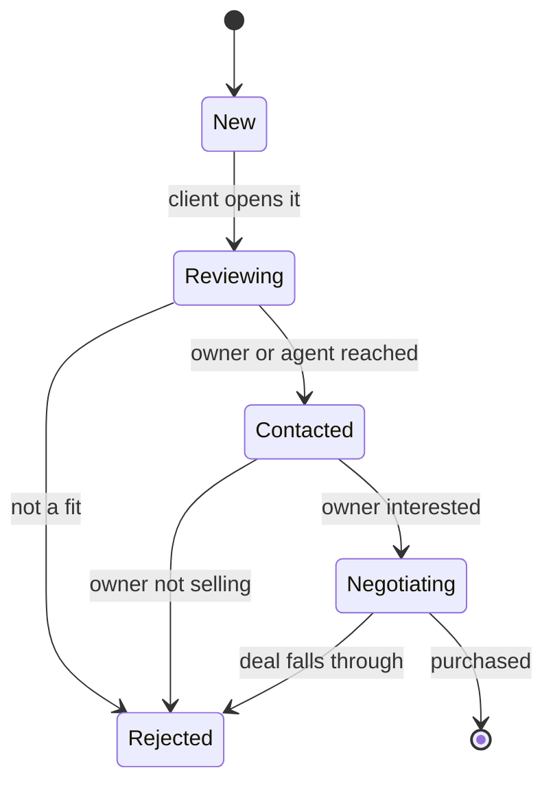

# Workflow

## 1. Data pipeline

`python manage.py run_pipeline` runs these steps in order. Each step only overwrites its own columns.

| Step | Function | Matches on | Writes |
| --- | --- | --- | --- |
| 1 | `load_hpd_buildings` | `hpd_building_id` | identity, address, unit counts, `last_seen` |
| 2 | `apply_class_b_list` | BIN, then BBL | `on_class_b_list` |
| 3 | `load_tax_balances` | BBL | `tax_owed`, `unpaid_periods`, `tax_as_of` |
| 4 | `load_lien_lists` | BBL | `lien_stage`, `lien_month`, `lien_water_only` |
| 5 | `load_registrations` | `registration_id` | `registration_end`, `owner_name`, `agent_name` |
| 6 | `score_all` | every building | `score`, `score_reasons` |

Step 2 runs only when a Class B file is given (`--class-b-file` or `CLASS_B_LIST_FILE`). Otherwise the run summary says it was skipped and existing flags stay.

If any step fails, the run stops, the error is saved on the `Run`, and the command exits with an error. Steps already completed keep their data.

## 2. Weekly operating routine

1. **Monday, automatic:** cron runs the pipeline.
2. **Operator checks Run history:** result OK, candidate count close to last week.
3. **Operator spot-checks five rows** against HPD Online and the DOF property tax site.
4. **When the city republishes the Class B list:** download it into `data/` and run `load_class_b_list`.
5. **Client works the list** (next section).

## 3. Working a lead

1. Filter the list (for example Class B listed, tax owed over $5,000).
2. Open a building and read why it ranks.
3. Follow the city-record links to check the certificate of occupancy or I-card.
4. Add a note with what was found and set the status.
5. Export to CSV when the list needs to be shared.

Before any offer, the client's attorney confirms legal occupancy and title.

## 4. Development workflow

1. Read the relevant section of `docs/specs.md` and `docs/data-sources.md`.
2. Write a failing test in `leads/tests/`.
3. Implement in `leads/services/` (or views/templates).
4. Run `python manage.py test leads`.
5. Run the pipeline for one zip code and check the result in the web app.
6. Update the docs and commit.
